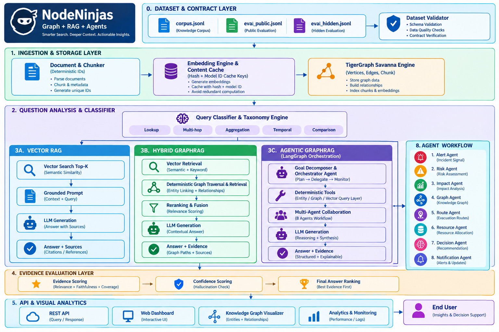

NINJA NODES
===========

Agentic GraphRAG system for intelligent investigation, evidence retrieval, and graph-based reasoning.

Ninja Nodes combines GraphRAG, TigerGraph, Agentic AI, MCP, and modern web technologies to build an intelligent investigation workflow over structured and unstructured data.

ARCHITECTURE
============

OVERVIEW
========

Ninja Nodes is a GraphRAG-based intelligent investigation platform designed to go beyond traditional vector search.

The system combines vector retrieval, graph-based retrieval, Hybrid GraphRAG, Agentic GraphRAG, TigerGraph, MCP-based tool interaction, and evaluation.

RETRIEVAL APPROACHES
====================

1. Vector RAG

Traditional Retrieval-Augmented Generation using vector similarity to identify relevant documents and evidence.

2. Hybrid GraphRAG

Combines semantic retrieval with graph relationships to improve contextual understanding.

3. Agentic GraphRAG

Uses an AI agent to dynamically decide:

- What information to retrieve
- Which tools to use
- Which entities to investigate
- When additional evidence is required
- How retrieved evidence should be connected

GRAPH INTELLIGENCE
==================

The graph layer represents relationships between entities and enables reasoning over connections that may not be obvious from isolated documents.

TigerGraph is used as the graph database layer for graph-based retrieval and relationship exploration.

AGENTIC AI WORKFLOW
===================

User Question
      |
      v
Investigation Agent
      |
      v
Query Planning
      |
      v
Retrieval and Tools
      |
      v
TigerGraph + Documents
      |
      v
Evidence Collection
      |
      v
Graph Reasoning
      |
      v
Final Answer

MCP INTEGRATION
===============

The project uses Model Context Protocol (MCP) concepts to allow AI agents to interact with external tools and data sources in a structured way.

This makes the architecture extensible and allows additional investigation capabilities to be added without redesigning the entire agent.

EVALUATION
==========

The repository contains evaluation datasets and benchmarking components for comparing different retrieval strategies.

Vector RAG
- Vector retrieval
- No graph reasoning
- No agentic behavior

Hybrid GraphRAG
- Vector retrieval
- Graph reasoning
- No agentic behavior

Agentic GraphRAG
- Vector retrieval
- Graph reasoning
- Agentic investigation

TECHNOLOGY STACK
================

AI and Retrieval
- Generative AI
- Agentic AI
- GraphRAG
- RAG
- LLM reasoning

Graph and Data
- TigerGraph
- Graph databases
- Vector retrieval
- Structured and unstructured data

Backend
- Python
- FastAPI
- Agent-based services

Frontend
- React
- TypeScript
- Vite

Infrastructure and Tools
- Docker
- Git
- GitHub
- MCP
- Automated evaluation

PROJECT STRUCTURE
=================

Ninja Nodes/
|
|-- .github/
|-- benchmark/
|-- graphrag/
|   |-- graphrag/
|   |-- graphrag-ui/
|   |-- report-service/
|   |-- tests/
|   |-- docs/
|   `-- licenses/
|
|-- corpus.jsonl
|-- eval_public.jsonl
|-- architecture.png
|-- .gitignore
`-- README.md

GETTING STARTED
===============

Clone the repository:

git clone <YOUR_REPOSITORY_URL>

cd Ninja-Nodes

Create a Python environment:

python -m venv .venv

Activate the environment on Windows:

.\.venv\Scripts\Activate.ps1

Install the required dependencies according to the setup instructions inside the graphrag directory.

PROJECT GOALS
=============

- Improve multi-hop retrieval
- Combine graph and semantic search
- Enable agent-driven investigation
- Compare multiple RAG architectures
- Evaluate retrieval and reasoning quality
- Build an extensible architecture for future AI agents

RESEARCH DIRECTION
==================

Traditional RAG
      |
      v
Vector RAG
      |
      v
Hybrid GraphRAG
      |
      v
Agentic GraphRAG
      |
      v
Adaptive Investigation

TEAM
====

Ninja Nodes

Built as an Agentic AI and GraphRAG project for exploring intelligent graph-based investigation systems.

LICENSE
=======

See the included license files and third-party dependency licenses in the repository.
