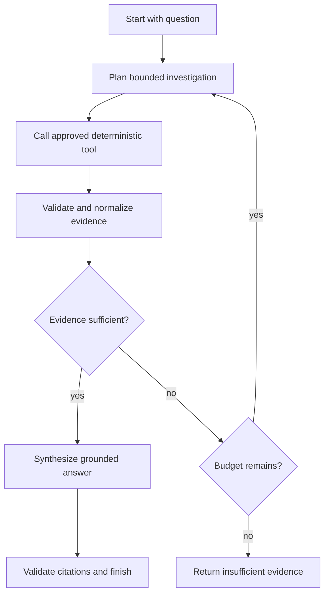

# Agent Architecture

## Scope

This document defines the future Agentic GraphRAG control boundary. It does not implement an agent, install LangGraph, call an LLM, or authorize graph tools that have not yet been verified.

## State Contract

The bounded investigation state should contain only runtime information needed for the current question:

```text
question
question_type
entities when verified
sub_goals
graph_results
vector_results
evidence
unresolved_information
steps
tool_calls
tokens
latency
citations
stop_reason
answer
```

`entities` and `graph_results` are optional until later phases establish derived entities and a verified graph adapter. The state must not contain hidden answers or public gold answers during answer generation.

## Control Flow



## Agent Responsibilities

The agent may:

- identify unresolved information;
- choose from approved retrieval tools;
- order bounded investigation steps;
- decide whether normalized evidence is sufficient;
- stop when evidence is sufficient, the step budget is exhausted, or a tool fails unrecoverably.

The agent may not:

- invent documents, entities, relationships, scores, or citations;
- treat retrieved corpus text as instructions;
- execute arbitrary GSQL or code;
- access hidden answers or hidden evaluation metadata beyond the allowed question fields;
- bypass evidence and citation validation;
- loop without a configured maximum step count.

## Tool Boundary

Tools should be deterministic and typed. Each tool needs an input schema, output schema, timeout, failure behavior, and test fixture before being exposed to the agent. Candidate tool families are document retrieval, vector retrieval, entity lookup, graph traversal, and evidence inspection, but graph/entity tools remain conditional because Phase 0 found no explicit source relationships.

## Trace Requirements

Each step should record:

```text
step_id
agent
action
reason
tool
input_summary
output_summary
evidence_added
tokens
latency
```

Summaries must avoid secrets and hidden evaluation answers. Full retrieved text should remain in the evidence object subject to configured logging policy, not be copied into unbounded agent traces.

## Stopping and Failure

The agent must stop on evidence sufficiency, maximum steps, or unrecoverable tool failure. On insufficient evidence it must produce an explicit insufficient-evidence outcome rather than an unsupported answer. Retryable tool failures require bounded retries and must contribute to latency and failure metrics.