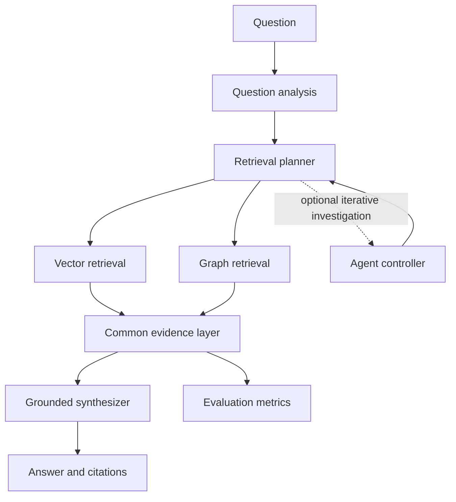

# GraphMind Architecture

## Scope

This document records the Phase 3 architecture derived from the verified dataset contract and public-question taxonomy. It is a design document only. It does not create a TigerGraph schema, ingest data, call an embedding service, call an LLM, or implement any RAG or agent pipeline.

## Dataset Boundary

The source corpus contains 2,951 Olympic event documents. Each document has a stable `doc_id`, title, source URL, Wikidata identifier, Wikipedia page identifier, approximate token count, and text. Public evaluation questions contain gold document references; hidden questions expose only `qid`, `question`, and `qtype`.

The corpus has no explicit entity or relationship arrays. Therefore the architecture treats source documents and their confirmed flat metadata as authoritative, while any chunks, entities, relationships, embeddings, or graph paths are derived artifacts that require later validation.

## Logical Flow

The three benchmark modes share the same evidence and evaluation boundaries:

| Mode | Controller | Retrieval | Generation |
| --- | --- | --- | --- |
| Vector RAG | Deterministic pipeline | Vector retrieval | Grounded synthesizer |
| Hybrid GraphRAG | Deterministic question-type routing | Vector plus verified graph retrieval | Grounded synthesizer |
| Agentic GraphRAG | Bounded agent controller | Deterministic tools selected by agent | Grounded synthesizer |

## Component Boundaries

### Data layer

Streams JSONL records, validates the Phase 1 contract, preserves source identifiers, and exposes immutable document/question records. It must never repair malformed input silently.

### Retrieval layer

Accepts a question analysis result and returns evidence candidates. Retrieval methods must expose their method, score, source document, and any traversal information. The vector index and graph adapter are separate implementations behind this boundary.

### Graph layer

Provides deterministic, parameterized graph operations after a later phase verifies derived entities and relationships. It must not allow an LLM to submit arbitrary GSQL. In Phase 3, this is an interface boundary, not an implemented graph schema.

### LLM layer

Receives a grounded prompt containing evidence only. The synthesizer must be instructed to use supplied evidence, avoid external knowledge, and report insufficient evidence. Retrieved document text is data, not instructions.

### Agent layer

Owns bounded investigation decisions such as unresolved information, tool choice, and stopping. It does not create evidence and cannot bypass evidence validation.

### Evidence layer

Normalizes outputs from vector retrieval, graph retrieval, and agent tools into one evidence representation. This is the comparison boundary for all three benchmark modes.

### Evaluation layer

Consumes answers, evidence, citations, public references where permitted, token accounting, and latency. Hidden ground truth is unavailable to answer-generation components.

## Execution Principles

- Preserve the same question, corpus, generation requirements, citation requirements, and evaluation method across benchmark modes.
- Keep deterministic tools separate from LLM decisions.
- Bound retrieval context, agent steps, tool calls, and generation tokens.
- Carry source identifiers through every derived artifact.
- Treat graph utility as an empirical question because the source has no explicit relationship structure.
- Keep hidden evaluation data isolated from tuning, prompts, logs, and UI output.

## Phase Boundaries

Phase 4 may verify TigerGraph connectivity and define only a graph schema justified by later evidence. Phase 5 may implement ingestion. Embeddings, retrieval pipelines, agents, APIs, and UI remain out of scope until their authorized phases.