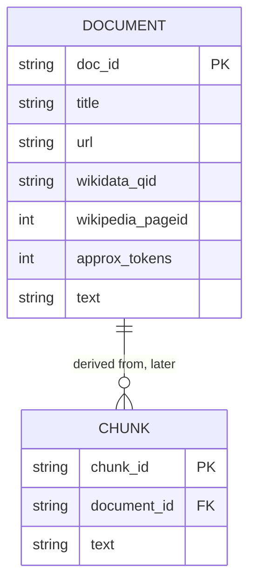

# Graph Schema Design Boundary

## Status

This is a Phase 3 design boundary, not a TigerGraph schema or GSQL script. No graph has been created and no data has been ingested.

## Evidence From the Dataset

The corpus confirms one stable document identifier, `doc_id`, plus title, URL, Wikidata identifier, Wikipedia page identifier, approximate token count, and text. It does not contain explicit entity collections, relationship collections, edge identifiers, or graph paths.

The following status labels prevent unsupported assumptions:

| Concept | Phase 3 status | Evidence |
| --- | --- | --- |
| Document | Confirmed | One record per corpus JSONL line with `doc_id` and `text` |
| Document metadata | Confirmed flat fields | Title, URL, Wikidata QID, Wikipedia page ID, approximate tokens |
| Chunk | Derived candidate | No chunk field in source; chunking is a later authorized operation |
| Entity | Not confirmed | No explicit entity field or entity list observed |
| Relationship | Not confirmed | No explicit relationship field or edge list observed |
| Question | Confirmed evaluation object | `qid`, question text, and `qtype` |
| Evidence path | Derived runtime object | Not present in source data |

## Provisional Logical Model

The minimum model that preserves confirmed source facts is:

`CHUNK` is shown only as a derived retrieval boundary and is not claimed to exist in the source. Entity and relationship vertices/edges are intentionally omitted because Phase 0 found no explicit evidence for them.

## Required Invariants For Later Phases

- Every derived chunk must retain exactly one source `doc_id`.
- Derived identifiers must be deterministic from source identity and derivation configuration.
- Source title, URL, Wikidata QID, and Wikipedia page ID must remain traceable.
- No entity or relationship type may be added without a documented extraction rule and validation evidence.
- Graph queries must be parameterized or use pre-approved query operations.
- The schema must support citation resolution back to corpus `doc_id` values.
- Public `gold_doc_ids` are evaluation references and must not be treated as graph truth during ingestion.

## Not Yet Decided

The following require later evidence and authorization: chunk size and overlap, entity extraction, relationship extraction, vertex and edge types, TigerGraph attributes, indexes, graph names, GSQL queries, embedding dimensions, and ingestion idempotency strategy.